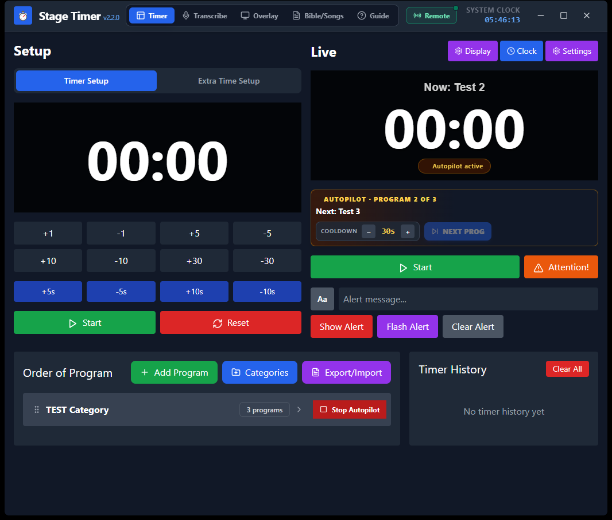

# Stage Timer App

**Stage Timer App v2.2.0** began as a simple timer for churches and worship centers. As the project grew, it expanded into a broader church media application for service planning, projection, transcription, and remote camera workflows. That evolution led us to rename the project **MediaGuy**.

Active development now continues in the dedicated [MediaGuy repository](https://github.com/johnbenet009/mediaguy). This repository contains the original Stage Timer App. To work with the latest project, visit MediaGuy, start it, and share your ideas, suggestions, bug reports, or contributions there.



## What This App Does

This Electron desktop app combines service timing and media presentation tools in one operator workspace. Its navigation includes Timer, Transcribe, Overlay, Bible/Songs, Cameras, and an in-app guide.

### Timer and Service Planning

- Setup and live timers with start, pause, resume, reset, attention, and time adjustment controls.
- Programs organized into categories, reorderable run of show, and timer history.
- Extra-time timer, clock, alerts, and audience-facing next-program notifications.
- Autopilot queue with configurable cooldown and automatic program transitions.
- Import/export tools for app data.

### Projection and Presentation

- Bible lookup by book, chapter, verse, and text search, with presentation history.
- Song library and slide editing, with Bible passages and song slides sent to a selected secondary display.
- Projection styling for fonts, colors, text layout, images, video, and camera backgrounds.
- Bible practice mode when no secondary screen is connected: preview passages in the app without opening a window over the primary screen.
- Timer and overlay display backgrounds, including images, video, and camera input.

### Transcription and Overlays

- Live speech transcription with editable text, transcript download, microphone setup, and AI-assisted social content tools.
- Overlay workspace for configuring timer, clock, and lower-third graphics for displays.

### Camera Mixer

- Connect phones as remote video sources using a camera-only invitation link.
- Preview sources, choose the program feed, rename cameras, and send messages to camera operators with acknowledgement and replies.
- Use a camera feed as a background override for timer, Bible, and song displays.
- Connect over local Wi-Fi or create a temporary HTTPS link for phone camera access with Online mode.

### Remote Access

- Start the built-in HTTP/WebSocket server and open the remote selection screen from a phone, tablet, or computer.
- Remote Timer control (including a phone-friendly layout), Timer display, Transcribe control/display, and Bible control.
- Camera-only phone invitations for sending video to the desktop Camera Mixer.
- Optional access PIN for remote controls.

Local remote access is intended for a trusted Wi-Fi or LAN. Its HTTP/WebSocket connection is not encrypted; do not expose the local server directly to the public internet. The PIN restricts access but does not encrypt traffic. Online camera mode uses a temporary Cloudflare HTTPS tunnel; keep it active only while needed.

This repository reflects the original Stage Timer App and may not include the newest changes. See [MediaGuy](https://github.com/johnbenet009/mediaguy) for the actively maintained project.

## Installation and Development

### Requirements

- Windows 10 or later for the documented desktop workflow.
- Node.js and npm for running from source.
- Git to clone either repository.

### Run from Source

```powershell
git clone https://github.com/johnbenet009/flexible-stage-timer.git
cd flexible-stage-timer
npm install
npm --prefix vite-core install
npm run build
npm start
```

The root `npm run build` command builds the Vite frontend and copies the production files into `public`. `npm start` launches Electron using those files. After changing frontend code, run `npm run build` again before restarting the desktop app. For the latest code and setup instructions, use the [MediaGuy repository](https://github.com/johnbenet009/mediaguy).

### Development Commands

```powershell
npm run dev       # Build the frontend, then launch Electron
npm run dev-vite  # Start the Vite frontend server only
```

The Vite-only command is useful for frontend iteration; native display selection, desktop projection windows, and the local remote server require Electron.

### Package the App

On Windows, the configured packaging commands are:

```powershell
npm run build-installer  # Build a Windows NSIS installer
npm run build-clean      # Build an unpacked Windows app and remove extra language files
```

Linux packaging scripts and electron-builder targets are present, but the root frontend-copy step currently uses Windows `xcopy`; Linux packaging may therefore require adapting that build step. A macOS packaging target is not configured.

## Data and Network Use

- Timer, program, and app settings are stored locally; there is no built-in cloud sync.
- Remote access serves the built app and synchronizes live state with connected devices.
- For Local Wi-Fi mode, put the host and remote device on the same trusted network.
- Allow the app through the operating system firewall on private networks if a device cannot connect.
- Stop remote broadcasting and Online tunnels when they are not needed.

## Keyboard Shortcuts

Shortcuts apply in the main Timer workspace when focus is not in a text field:

| Key | Action |
| --- | --- |
| `Space` | Start, pause, or resume the live timer |
| `S` or `R` | Reset the live timer |
| `A` | Toggle attention mode |
| `N` | Advance to the next program / autopilot action |
| `C` | Show the system clock |

## Project Layout

```text
main.js                 Electron main process and app services
preload.js              Renderer-to-Electron API bridge
remote-server.js        Local HTTP and WebSocket remote server
public/                 Built frontend served by Electron and remote devices
vite-core/src/          React and TypeScript frontend source
```

## Join the Project

We would love to have you join us on the next stage of this project. Visit [github.com/johnbenet009/mediaguy](https://github.com/johnbenet009/mediaguy), try it out, and share your suggestions, report issues, or contribute code.

When reporting an issue, include your operating system, app version, steps to reproduce, expected and actual behavior, and a screenshot when safe to share. For code contributions, describe the change and how it was tested. Avoid including private network addresses, access PINs, personal data, or lyrics without permission.

## License

This project is distributed under the [MIT License](LICENSE.txt).

## Project Author

**Positive Developer** - [@johnbenet009](https://github.com/johnbenet009)
