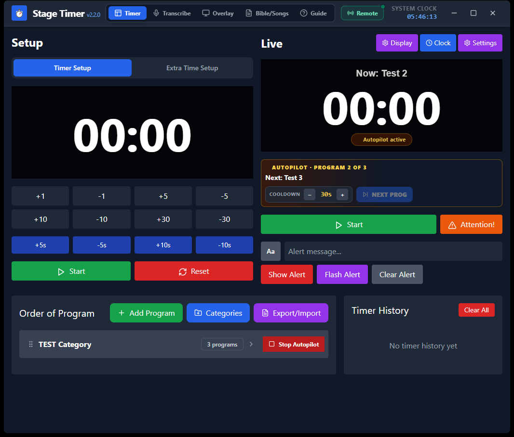

# Stage Timer App

**Stage Timer App v2.2.0** is a desktop application for managing live event timing, program order, stage-facing displays, and local-network remote controls. It is built with Electron, React, and TypeScript.



## Project Status

The timer and program-management workflows are the current core of the application. The **Overlay** and **Bible / Lyrics** areas are under active development. Their current screens and projection workflows are incomplete and may change; they should be treated as work in progress, not finished production features.

The current remote selector supports Timer and Transcribe workflows. Remote Overlay and Bible / Lyrics workflows are part of the future direction, but are not available yet.

## Features

### Timer and Programs

- Separate setup and live timers, with start, pause, reset, attention, and time-adjustment controls.
- Organize programs into categories, reorder the run of show, and start a program directly.
- Timer history with the ability to run a previous program again.
- Extra-time timer for extending a program.
- Optional clock, on-screen alerts, and audience-facing "Up Next" notifications.
- Autopilot queue with a configurable cooldown and an automatic next-program transition screen.
- Custom timer display backgrounds, including images, video, and webcam input.
- Multi-display support for routing the timer and other outputs to available screens.

### Transcribe

- A desktop workspace for live transcription and transcript editing.
- Remote Transcribe control and display pages for supported devices on the same local network.

### Remote Access

- Start a local-network server from the Remote Access dialog.
- Scan the QR code or open the link to reach a remote selection screen first.
- Choose Timer Control, a phone-friendly Timer Control layout, Timer Display, Transcribe Control, or Transcribe Display.
- Optionally protect remote WebSocket controls with an access PIN.

Remote access is intended for devices on the same trusted Wi-Fi or LAN. The server uses HTTP and WebSocket without TLS; do not expose its port directly to the public internet. The PIN protects remote state and commands, but does not encrypt network traffic.

### In Development: Overlay and Bible / Lyrics

These workspaces are being developed toward a more complete presentation and projection workflow:

- **Overlay:** continue refining the broadcast graphics, controls, display routing, and live behavior.
- **Bible / Lyrics:** continue refining scripture lookup, lyric slide preparation, projection, and the overall operator workflow.
- **Remote workflows:** remote Overlay and Bible / Lyrics selection and control are planned, but are not currently available.

There is no release timeline yet. The README will be updated as these areas become ready for regular use.

## Installation and Development

### Requirements

- Windows 10 or later for the configured desktop build.
- Node.js and npm for running from source.
- Git to clone the repository.

### Run from Source

```powershell
git clone https://github.com/johnbenet009/flexible-stage-timer.git
cd flexible-stage-timer
npm install
cd vite-core
npm install
cd ..
npm run build
npm start
```

The root `npm run build` command builds the Vite frontend and copies the production files into `public`. `npm start` launches the Electron app using those files. After changing frontend code, run `npm run build` again before restarting the app.

### Development Commands

```powershell
npm run dev       # Build the frontend, then launch Electron
npm run dev-vite  # Start the Vite frontend server only
```

The Vite-only command is useful for frontend iteration; Electron-only features such as native display selection and the local remote server require the desktop app.

### Package the App

On Windows, the configured packaging commands are:

```powershell
npm run build-installer  # Build a Windows NSIS installer
npm run build-clean      # Build an unpacked Windows app and remove extra language files
```

Linux packaging scripts are present but the root frontend-copy step currently uses Windows `xcopy`, so native Linux builds are not documented as supported. A macOS packaging target is not configured.

## Data and Network Use

- Timer, program, and app settings are stored locally by the desktop application; there is no built-in cloud sync.
- Remote access serves the built app and synchronizes live state over the local network.
- The computer hosting remote access and the remote device should be on the same trusted network.
- Allow the app through the operating system firewall on private networks if the remote device cannot connect.
- Stop remote broadcasting when it is not needed.

## Keyboard Shortcuts

Shortcuts apply in the main Timer workspace when focus is not in a text field:

| Key | Action |
| --- | --- |
| `Space` | Start, pause, or resume the live timer |
| `S` or `R` | Reset the live timer |
| `A` | Toggle attention mode |
| `N` | Advance to the next program / autopilot action |
| `C` | Show the system clock |

## Project Layout

```text
main.js                 Electron main process and app services
preload.js              Renderer-to-Electron API bridge
remote-server.js        Local HTTP and WebSocket remote server
public/                 Built frontend served by Electron and remote devices
vite-core/src/          React and TypeScript frontend source
```

## Contributing and Issues

Bug reports and contributions are welcome. For an issue, include your operating system, app version, steps to reproduce, expected and actual behavior, and a screenshot when it is safe to share.

For code contributions, describe the change and how it was tested. UI changes should include updated screenshots where possible. Avoid including private network addresses, access PINs, personal data, or lyrics without permission.

## License

This project is distributed under the [MIT License](LICENSE.txt).

## Author

**Positive Developer** - [@johnbenet009](https://github.com/johnbenet009)
